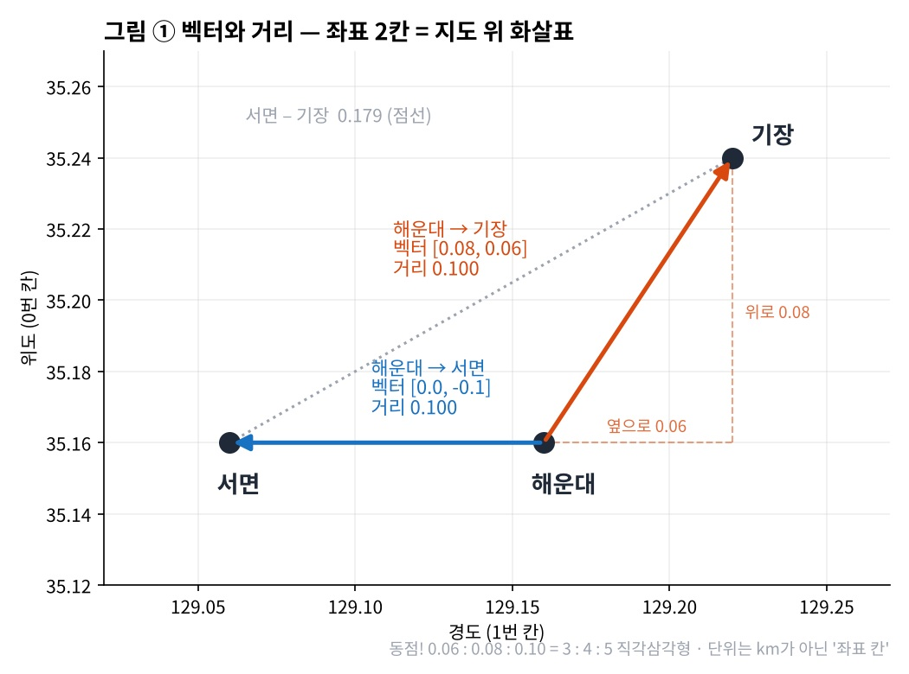
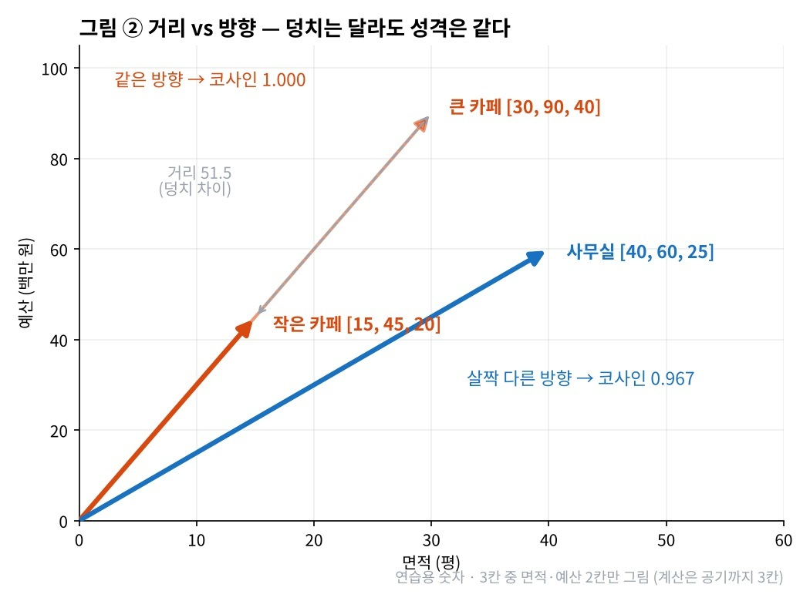
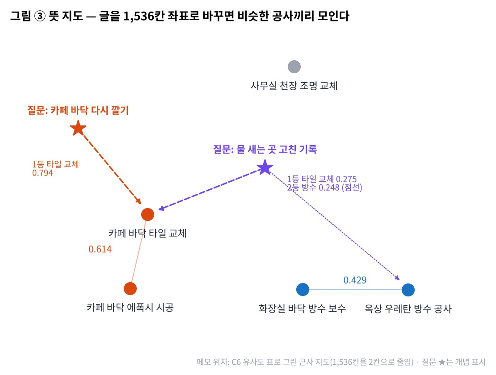

# M2·W3 수학 설명 노트 — 현장 좌표에서 AI의 뜻 지도까지

> 연습용 숫자·메모입니다. 실제 고객·주소·견적 금액은 없습니다.

## 그림 ① 벡터와 거리

- 벡터: 좌표
- 순서가 중요한 이유: 어떤 값을 먼저 부르냐에 따라 도면이 달라지므로
- 거리:  대각선 값이 같다.(해운대-서면 = 해운대-기장 = 0.100, 동점)

## 그림 ② 거리 vs 방향(코사인)

- 거리는 덩치,위치를 비교한다
- 코사인 유사도는 크기를 무시하고 방향을 본다.
- 작은 카페 vs 큰 카페: 거리 51.5 / 방향 1.000 → 이유: 각 값의 크기가 두배 차이나 거리는 머나 코사인 유사도는 같은 방향을 가진다.

## 그림 ③ 뜻 지도 (임베딩 + 미니 검색기)

- 임베딩: 단어들을 숫자로 바꾼 메모 덩어리 (칸 수 1,536)
- 검색: "카페 바닥 다시 깔기" → 타일 교체 0.794 → 이유: 각 단어간의 숫자의 방향이 유사해서
- 배운 점: "물 새는 곳 고친 기록" → 1등이 방수가 아니었다 → 방수라는 단어와 물 새는 곳 고친 기록의 숫자 거리가 생각보다 멀다. 메모가 짧아서 정확한 정보가 담기지 못했다

## 이번 주 공구 정리

| 공구 | 하는 일 | 현장 말 |
|---|---|---|
| `distance_n` | 두 좌표 사이 직선거리 | 줄자로 대각선 재기 |
| `dot` | 칸끼리 곱해서 더하기 | 두 카드가 같은 쪽을 보는 점수 |
| `norm` | 화살표 길이 | 카드의 덩치 |
| `cosine` | 방향이 얼마나 같은가 | 축적이 달라도 같은 도면 |
| `embeddings.create` | 글 → 1,536칸 좌표 | 글을 숫자로 바꿔 표를 만듬 |